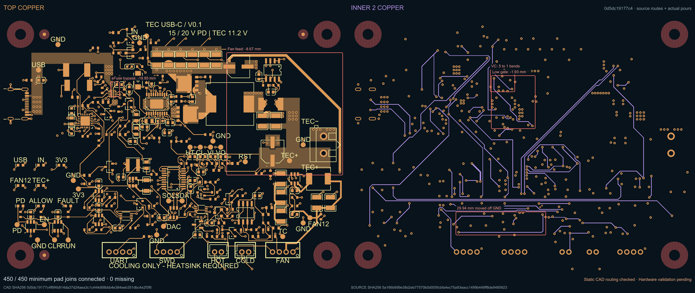

# USB-C Peltier development board

An editable tscircuit prototype targeting **15/20 V USB-C PD input and an 11.2 V TEC output**, with cooling-only control, 8 debug LEDs and 26 test points. All 194 fitted components retain their reviewed JLCPCB mappings and imported footprint geometry.



Source24 connects **450/450 required pad joins, 0 missing**. Fresh all-layer Gerber shorts, independent native copper checks and routing lint pass. Twenty agent reviewers, including five Astra/high agents, give the whole board **7.7/10** on average (range 7.1–8.4); Source23 averaged 7.2/10.

| Measured routing | Source23 | Source24 |
|---|---:|---:|
| eFuse output-cap feed |23.026 mm|3.174 mm|
| CdVdt signal path |11.013 mm|5.568 mm|
| VC compensation path |15.185 mm|12.688 mm|
| Complete LOW gate path |28.335 mm|26.402 mm|
| Protected fan feed |90.592 mm|81.922 mm|
| Signal routing on inner1 |327.930 mm|289.687 mm|
| Total planar trace |4078.583 mm|4044.303 mm|
| Through vias |433|434|

The output-cap move lengthens its permission pickup by 10.586 mm; this cost is included in the total savings. The shared 3.3 V branch replaces one redundant trace and via. A moved ground probe makes ADC measurements easier; its label clears the actual mask openings and nearby legend. Both moved capacitors retain authentic supplier courtyards.

This remains a static CAD prototype. Hardware bench validation and manufacturing exports/tolerances are pending. Long gate/fan/UART paths, a remote raw-input bypass and remaining inner1 corridors are documented in the reviews. The closest foreign via pair is 0.175 mm against the established 0.15 mm rule; several other routes retain tight nominal margins.

- [Editable board](index.tsx), [checked circuit JSON](captured-pcb/circuit.json) and [ground-plane view](captured-pcb/19-source-routing-improved-ground-inner1.png)
- [All 20 exact-capture routing reviews](routing-review/source24/README.md), [qualification](routing-review/source24/qualification.json) and [checks](routing-review/source24/checks)
- [Source23 review](routing-review/rating-report.txt) and [original crossing annotation](routing-review/suspected-short-net-review.png); the crossing is intentional shared V3V3 copper
- [Published tscircuit package](https://tscircuit.com/0hmX/tec-usbc-board)

Clone and open the board:

```sh
git clone https://github.com/0hmX/usb-c-peltier-board.git
cd usb-c-peltier-board
bun install --frozen-lockfile
python3 restore-captured-runtime.py
bun run typecheck
bun run dev
```

Restore the six captured runtime files after installation. They contain the routing/via fixes used by the capture; the helper verifies package versions and every file hash before copying.

Regenerate the source routes and pours:

```sh
bun run build -- --placement-only --pcb-only --phase-timeout-seconds 900
```

A new capture needs fresh geometry checks. Original package scripts are preserved; these aliases require tooling outside this compact repository: `check:guarded`, `check:physical`, `check:routed`, `export:jlcpcb`, `export:kicad`, `export:previews` and `prepare:assembly`.

All 150 canonical source files and six runtime payloads are retained. Twelve source files changed; all 105 part/import files and every runtime byte match Source23. [Current provenance](PACKAGE-PROVENANCE.json) identifies the new capture; [original Source23 provenance](docs/source23-package-provenance.json) and [original package README](docs/captured-source-package-README.md) remain historical evidence. Supplier snapshots record stock observed on their stated dates.

The project retains its declared MIT license. Captured runtime packages retain their [upstream license notices](docs/third-party-licenses).
