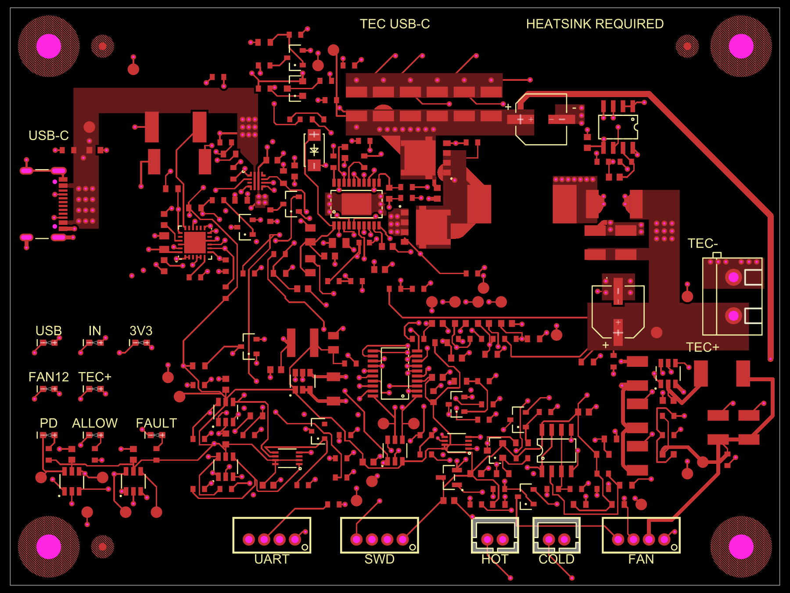

# USB-C Peltier development board

A tscircuit prototype targeting **15/20 V USB-C PD input and an 11.2 V TEC output**, with cooling-only control, 8 debug LEDs and 26 test points. All 194 fitted components retain their reviewed JLCPCB mappings, pads, drills, courtyards and placement.

The default entry is the real editable board in `index.tsx`. It renders the source components, footprints, netlist and 548 manual routes, then replays 88 saved ground fanouts through `pcbTracePaths`. Preview and build run no routing solvers. The native copper-pour pipeline runs once; all 636 traces, 434 through vias and 31 pours match the checked `captured-pcb/circuit.json` exactly.

`regenerate.tsx` enables the full routing phases on the same board for explicit regeneration. Its routing algorithms are isolated in `src/regeneration-routing.tsx`; the default source does not import them. Both router helpers use the declared `eventemitter3@5.0.4` runtime dependency.

The current silkscreen has 22 text elements, down from 234. Connector names, TEC and capacitor polarity, eight LED functions, board identity and a short heatsink reminder remain. Component names, probe labels and nonpolar capacitor/inductor outlines were removed. Saved physical geometry and connectivity are unchanged; the real TSX makes USB insertion direction explicit and updates its derived cable insertion center. Labels use 1.7 mm font size, and both alphabet and Gerber geometry checks pass with at least 0.15 mm clearance. [Verification](publication-checks/silkscreen-cleanup.json) records the historical cleanup hashes and checks.



Bottom headers, viewed left to right in the top view:

| Header | Pin order |
|---|---|
| FAN | PWM, TACH, +12V, GND |
| SWD | GND, SWCLK, SWDIO, 3V3 |
| UART | 3V3, RX, TX, GND |

The small circle marks pin 1, the rightmost header pin. HOT and COLD take two-wire thermistors; TEC+ is the lower output pin. Probe names, nets and coordinates remain in [debug-data.ts](src/blocks/debug-data.ts), with an annotated [probe map](captured-pcb/probe-map.png) for bench work.

Source24 connects **450/450 required pad joins, 0 missing**. Fresh all-layer Gerber shorts, independent native copper checks and routing lint pass. Twenty agent reviewers, including five Astra/high agents, give the whole board **7.7/10** on average (range 7.1–8.4); Source23 averaged 7.2/10.

| Measured routing | Source23 | Source24 |
|---|---:|---:|
| eFuse output-cap feed |23.026 mm|3.174 mm|
| CdVdt signal path |11.013 mm|5.568 mm|
| VC compensation path |15.185 mm|12.688 mm|
| Complete LOW gate path |28.335 mm|26.402 mm|
| Protected fan feed |90.592 mm|81.922 mm|
| Signal routing on inner1 |327.930 mm|289.687 mm|
| Total planar trace |4078.583 mm|4044.303 mm|
| Through vias |433|434|

The output-cap move lengthens its permission pickup by 10.586 mm; this cost is included in the total savings. The shared 3.3 V branch replaces one redundant trace and via. A moved ground probe makes ADC measurements easier; its label clears the actual mask openings and nearby legend. Both moved capacitors retain authentic supplier courtyards.

This remains a static CAD prototype. Hardware bench validation and manufacturing exports/tolerances are pending. Long gate/fan/UART paths, a remote raw-input bypass and remaining inner1 corridors are documented in the reviews. The closest foreign via pair is 0.175 mm against the established 0.15 mm rule; several other routes retain tight nominal margins.

- [Editable TSX board](index.tsx), [checked circuit JSON](captured-pcb/circuit.json), [regeneration board](regenerate.tsx) and [ground-plane view](captured-pcb/19-source-routing-improved-ground-inner1.png)
- [All 20 exact-capture routing reviews](routing-review/source24/README.md), [qualification](routing-review/source24/qualification.json) and [checks](routing-review/source24/checks)
- [Source23 review](routing-review/rating-report.txt) and [original crossing annotation](routing-review/suspected-short-net-review.png); the crossing is intentional shared V3V3 copper
- [Published tscircuit package](https://tscircuit.com/0hmX/tec-usbc-board)

Clone and preview the editable board:

```sh
git clone https://github.com/0hmX/usb-c-peltier-board.git
cd usb-c-peltier-board
bun install --frozen-lockfile
bun run typecheck
bun run dev
```

`bun run build` compiles `index.tsx` into `dist/index/circuit.json`. The TSX entry installs the reviewed eFuse pin anchors and preserves inline via dimensions through public rendering APIs; no dependency patches are needed. `bun run check:saved-routes` checks all 7,968 records across 37 types, repeated via repair, partial diameter metadata and the absence of routing solvers. It normalizes only unreferenced generated silkscreen/warning IDs and runtime instance numbers, and asserts the exact USB metadata change. `bun run scripts/assert-saved-circuit.ts dist/index/circuit.json` applies the same comparison to CLI output with its filesystem metadata checked separately. [Verification](publication-checks/tsx-preview.json) records the result. The small JSON config excludes generated `checks` and `dist` directories from dev uploads and watching; the TS config retains the local supplier cache. The pinned CLI dev loader reads ignore settings only from JSON.

To explicitly regenerate the source routes and pours with the historical runtime:

```sh
python3 restore-captured-runtime.py
bun run build:regenerate -- --placement-only --pcb-only --phase-timeout-seconds 900
```

A new capture needs fresh geometry checks. Original package scripts are preserved; these aliases require tooling outside this compact repository: `check:guarded`, `check:physical`, `check:routed`, `export:jlcpcb`, `export:kicad`, `export:previews` and `prepare:assembly`.

The routing algorithms and configuration remain available in `src/regeneration-routing.tsx` and `regenerate.config.ts`. The default preview is PCB-only, matching the checked capture. Saved fanout paths retain absolute coordinates in both entries; moving their connected parts requires updating those paths before rebuilding or regenerating and rechecking the board. The captured JSON and six historical runtime payloads remain unchanged. [Original publication verification](publication-checks/static-preview.json) and historical routing snapshots describe the capture before silkscreen cleanup. [Current provenance](PACKAGE-PROVENANCE.json), [Source24 routing provenance](docs/source24-routing-provenance.json), [Source23 provenance](docs/source23-package-provenance.json) and [original package README](docs/captured-source-package-README.md) distinguish the publication wrapper from the checked CAD capture. Supplier snapshots record stock observed on their stated dates.

The project retains its declared MIT license. Captured runtime packages retain their [upstream license notices](docs/third-party-licenses).
