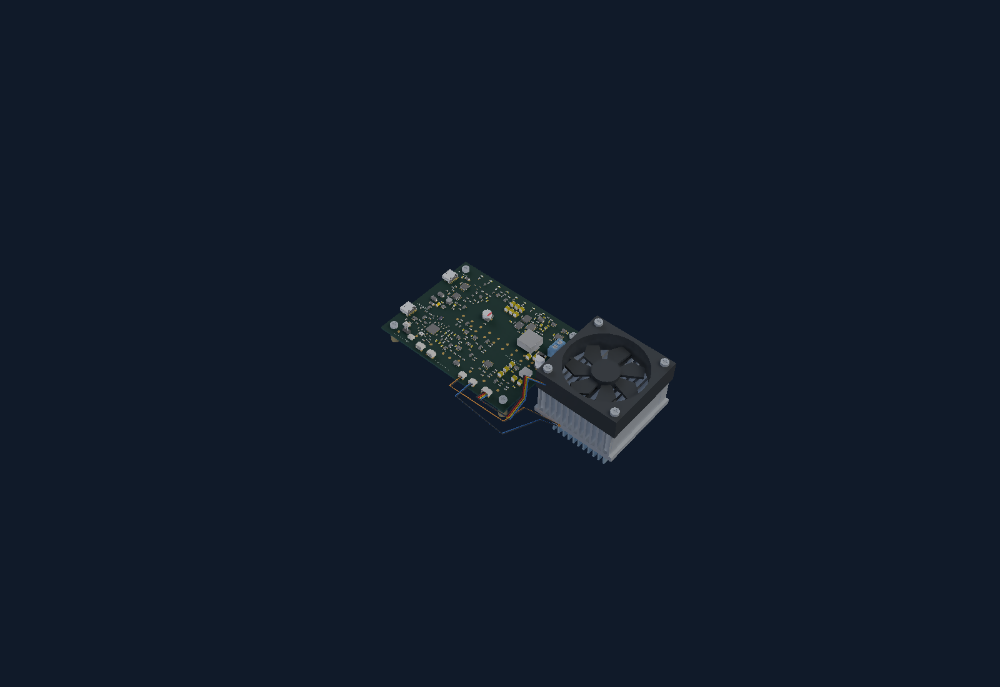
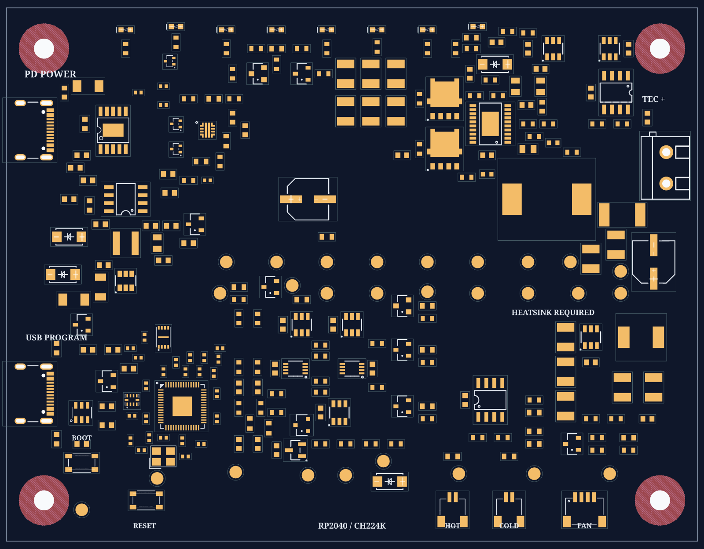

# Programmable dual-USB-C Peltier board

**Revision B is an unrouted placement-review design, not a fabrication release.**

The default `index.tsx` builds a **110 × 85 mm, four-layer** board with:

- **RP2040** controller, W25Q16 QSPI flash, 12 MHz crystal, BOOT/RESET buttons and local decoupling.
- **CH224K** PD controller and three open-collector selection buffers, following the referenced motor-controller architecture.
- Two independent standard USB-C receptacles: **PD POWER** and **USB PROGRAM**.
- **USB-C is the only programming interface.** UART/SWD headers, their four series resistors and the SWD SERVICE jumper are removed. BOOT/RESET buttons remain available for USB bootloader access.
- HOT/COLD and fan use side-entry JST SH connectors.
- Retained LT3741 current-controlled TEC stage, protected input, thermal interlocks, fail-off latches, fan circuit and test access.
- Hardware input-loss memory prevents automatic recovery after an established eFuse input drops out, including overvoltage shutdown. Deliberately taking RUN low is required to clear it; see [interlock behavior and validation](docs/revision-b-interlock.md).

The standard connector helpers are included as a connector-only snapshot of v0.8.0 in `src/board/parts/standard-jst-programmer.js`. This avoids the upstream full-programmer module's unrelated `fanoutTracePath` initialization, which fails in the browser evaluator's bundled props version. Geometry, pin labels and supplier CAD are unchanged and compared with the installed module in tests; hashes and provenance accompany the snapshot. Both source entry points are also tested with registry/CDN loading unavailable.

## Repository layout

`src/board/` contains Revision B; `src/legacy/` contains the original board and routing; `src/parts/` contains shared supplier parts and `imported/` components. Root entry points are `index.tsx`, `assembly.tsx` and `regenerate.tsx`. Build/export tools live in `scripts/`, regression tests in `tests/`, design notes in `docs/`, and current previews in `review/`.

Historical captures, routing reviews and publication checks live under `archive/` in their original directory names. Publication manifests are in `archive/publication/`; captured runtime files are in `archive/runtime/` and `archive/runtime.zip`. These records retain their original bytes, hashes and historical paths. To restore that runtime after installing dependencies, run `python3 scripts/restore-captured-runtime.py` from the repository root.

## Review the result

Open [the local review page](review/index.html), [placement image](review/placement.png), or [vector placement](review/placement.svg). Eight schematic sheets live in [review/schematics](review/schematics). [Component coordinates](review/placement.csv), [Circuit JSON](review/circuit.json) and [checks](review/checks.json) accompany the previews.

### Device concept assembly

The earlier [published native tscircuit build](https://0hmx--dual-usb-peltier-assembly-v0-1-4.tscircuit.app/#file=assembly.tsx) provides PCB, Schematic and 3D tabs for the previous design with UART/SWD headers. The regenerated local previews below show the current USB-C-only programming revision.



Open the [rotatable 3D assembly](review/assembly/index.html), [isometric preview](review/assembly/isometric.png), [native assembly drawing](review/assembly/assembly.svg), or [GLB model](review/assembly/peltier-assembly.glb). The standalone viewer embeds its renderer and model; it does not require a server or CDN. WebGL is needed for interaction, with saved images available as a fallback.

`index.tsx` and `assembly.tsx` now open the complete device concept in tscircuit's documented [`assembly.device`](https://docs.tscircuit.com/elements/assembly-device), not just the PCB. The native PCB and eight schematic sheets remain available. The 3D view additionally includes a conceptual TEC, hot/cold thermal hardware, fan, mounting supports and visual harnesses beside the unchanged controller board. Supplier component models and their transforms are preserved; test pads remain flat copper. See [assembly scope and regeneration](docs/revision-b-assembly.md) and the [model/parity audit](review/assembly/assembly-report.json).

```sh
bun run preview:assembly
bun run dev:assembly
```

External mechanical parts are explicitly named `CONCEPT`; their approximate dimensions illustrate arrangement, not supplier identity, thermal performance, harness qualification or fabrication-ready fit. No enclosure or airflow performance is certified. The fan and its harness still need qualification within the JST SH connector's 1 A limit, including startup and stall. The high-current TEC retains its separate power terminal. Visual wires do not add electrical nets or establish a validated wiring harness. Routing and all previous release gates still apply.



The default placement and assembly entries contain **no PCB traces, vias or copper pours**. The separate routed entry below adds saved copper. Component pads and courtyards are real CAD geometry, not an illustrative mockup. Four 3.2 mm mounting holes have 4 mm-radius washer/copper keepouts. The routed draft is available below; remaining routing and hardware qualification are later work.

## Reproduce

### Revision B routing

[`routed.tsx`](routed.tsx) renders explicit four-layer copper with the routing-specific
placement in [`routing-placement.tsx`](routing-placement.tsx). The original
`index.tsx` and `assembly.tsx` retain the unrouted review. Ten routing agents,
including three Astra agents, contributed all 135 net plans.

Review [four copper layers](review/routing/index.html), [connection results](review/routing/routing-report.json),
[physical copper connectivity](review/routing/physical-connectivity.json), and
[routing methods and validation](docs/revision-b-routing.md).
`check:routed` requires every net and ground pad to connect through actual copper,
zero geometric errors or shorts, valid exposed bypass lengths, and independent
shunt sense paths. Fabricator stackup/impedance and bench current/thermal
qualification remain separate from these CAD checks.

```sh
bun run route:revision-b
bun run build:routed
bun run check:routed
bun run node_modules/tscircuit/cli.mjs check shorts dist/routed/circuit.json --mode gerber --layer all
bun run export:routed
bun run node_modules/tscircuit/cli.mjs dev routed.tsx
```

```sh
bun install --frozen-lockfile
bun run typecheck
bun run build:review
bun run check:revision
bun run check:source-evaluator
bun run export:review
bun run dev
```

`build:review` does not route the board. The revision-specific checker verifies retained and critical new pin/net assignments, the input-loss interlock, two standard USB connectors, absence of UART/SWD interfaces, the four unconnected MCU pins, schematic-sheet coverage, placement errors, courtyards and absence of routed copper. The [change audit](review/usb-c-programming-change-audit.json) records the earlier USB-C-only programming change; subsequent input-loss and LT3741 placement changes are described in the design notes and regenerated review artifacts. Native tscircuit netlist and placement checks supplement this; none constitutes analogue simulation or bench validation.

Geometric DRC, schematic placement and [PCB placement analysis](review/placement-check.txt) pass with no placement issues after correcting passive orientations. Generic-passive sourcing and schematic-sheet-format warnings remain in the validation report.

PCB coordinates are explicitly editable in `src/board/clearance-placements.ts`; schematic refinements are in `src/board/schematic-refinements.ts`. Changing a footprint or coordinate requires fresh checks and preview exports.

The hosted build package includes circuit source and its assets. `tscircuit.config.json`
excludes review outputs, archives, documentation, tooling and tests from package
uploads, selects `index.tsx` explicitly, and uses the pinned dependency versions.
The TypeScript configuration shares those settings and adds the supplier cache.
All review files remain available in this repository.

`check:source-evaluator` evaluates both current entrypoints offline and repeats the revision checks. `check:saved-routes` separately validates the historical routed board through `scripts/legacy-saved-board.tsx`; its copper counts do not describe Revision B. Both commands remove their previous success report before validation starts. Run `bun test tests` for the regression suite, including the input-loss latch behavior.

## Power and service behavior

- PD-only: the logic runs at the initial 5 V supply; firmware may request qualified 15/20 V operation. Load permission remains hardware gated.
- Programming-only: USB supplies logic through a separate OR diode. It does **not** feed the TEC/fan power rail.
- Programming cable connected: a hardware transistor inhibits **both TEC and fan power**, regardless of MCU/boot-ROM behavior. A USB data switch isolates D+/D− when programming VBUS is absent.
- USB bootloader access: hold **BOOT** while connecting USB PROGRAM, or hold BOOT while pressing and releasing **RESET** on a powered board. The USB programming cable supplies logic and inhibits both loads.
- CH224K does not expose negotiated current/capabilities. Do not infer a 3/5 A contract from voltage or PG. Use a qualified ≥3 A adapter and a conservative firmware budget; the former selectable high-current eFuse mode is removed.

See [design notes and open qualifications](docs/revision-b-design.md) and [expert-review findings](docs/revision-b-reviews.md). Firmware is not included.

## Sources and history

- [Original Peltier project](https://github.com/0hmX/usb-c-peltier-board), base commit `64439f138ed1e1dc0822179b549ba1345b93a390`.
- [RP2040 motor-controller reference](https://tscircuit.com/imrishabh18/rp2040-motor-controller), v1.0.42.
- [Standard JST programmer](https://tscircuit.com/tscircuit/standard-jst-programmer), v0.8.0, installed via the tscircuit registry.

The earlier routed single-USB/STM32/STUSB4500 source is preserved in `src/legacy/board.tsx` and `regenerate.tsx`; its saved capture remains in `archive/captured-pcb/`. [Historical documentation](docs/legacy-readme.md) describes that revision only. Its routing measurements, electrical checks and assembly exports do **not** apply to Revision B. No fabrication files or orders are generated for this unrouted design.
