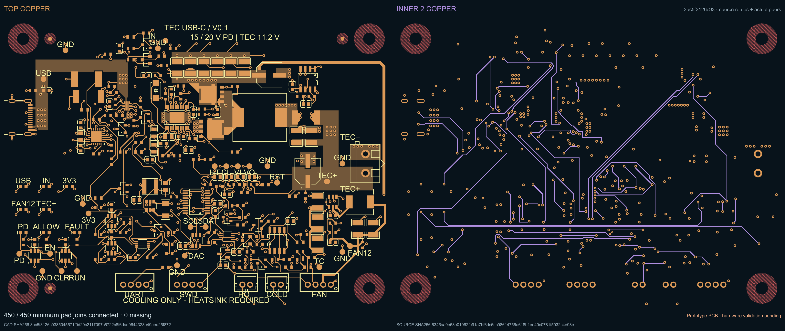

# USB-C Peltier controller

An editable tscircuit prototype for a USB-C PD-powered Peltier development board. This revision targets **15/20 V PD input and an 11.2 V TEC output**, with cooling-only control, 8 debug LEDs and 26 test points. The populated components carry JLCPCB part mappings; imported footprints were reviewed and corrected in place.



The checked Source23 capture has **450/450 required pad connections joined, 0 missing**, 633 trace objects and 433 vias. Twenty independent routing reviewers rated it **7.2/10** on average (range 6.4–8.2). Fresh all-layer Gerber and independent native copper checks found no foreign-net shorts in that capture. The pictured crossing joins the same 3.3 V supply net.

This remains a static CAD prototype. Manufacturing exports, assembly tolerances and hardware bench validation are pending. Main routing improvements are shorter gate-drive/compensation paths, closer eFuse bypass capacitors, fewer signal corridors through the main ground plane, and shorter fan/UART detours.

- [Editable board](index.tsx)
- [Checked circuit JSON](captured-pcb/circuit.json) and [ground-plane view](captured-pcb/18-source-routing-complete-ground-inner1.png)
- [All 20 routing scores](routing-review/rating-report.txt), [individual reports](routing-review/reviews), and [measurement evidence](routing-review/checks)
- [Annotated crossing](routing-review/suspected-short-net-review.png)
- [Published tscircuit package](https://tscircuit.com/0hmX/tec-usbc-board)

Clone and open the board:

```sh
git clone https://github.com/0hmX/usb-c-peltier-board.git
cd usb-c-peltier-board
bun install --frozen-lockfile
python3 restore-captured-runtime.py
bun run typecheck
bun run dev
```

Restore the six captured runtime files after installation. They contain the routing and via fixes used by the checked capture; a stock dependency installation alone does not reproduce that geometry. The restore helper verifies the installed package versions and every captured file hash before copying.

To regenerate the source routes and pours:

```sh
bun run build -- --placement-only --source-precomputed-only --pcb-only --phase-timeout-seconds 900
```

A regenerated board is a new capture and requires its own geometry checks. The original package scripts are preserved; these compact-archive aliases refer to tooling outside this repository: `check:guarded`, `check:physical`, `check:routed`, `export:jlcpcb`, `export:kicad`, `export:previews`, and `prepare:assembly`.

The 150 captured source files, six runtime payloads, checked board and supplier observations are retained. Supplier snapshots are dated evidence, not current stock reservations. `PACKAGE-PROVENANCE.json` describes the original source ZIP; its original README is preserved at [docs/captured-source-package-README.md](docs/captured-source-package-README.md). This repository adds this README, licensing, Git ignore rules and the later routing review. Source files and runtime payloads remain byte-identical to the checked archive.

The project retains its declared MIT license. Captured runtime packages retain their [upstream license notices](docs/third-party-licenses).
